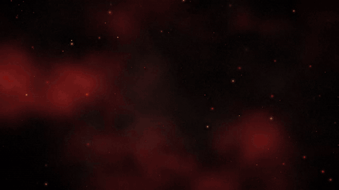
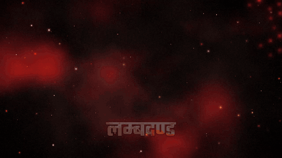
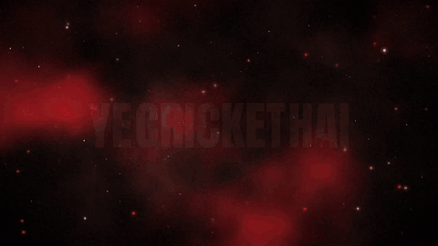

# Lyric Video Skill for Claude

**Turn a song and its lyrics into a cinematic, beat-synced lyric video.** Huge distressed words that slam, stamp and
glitch exactly when they are sung, over a smoky red-and-black world with fire, embers and camera shake. Works with
Devanagari, Hinglish and English lyrics.

It is a [Claude skill](https://docs.claude.com/en/docs/agents-and-tools/agent-skills/overview): Claude acts as the
director, and a set of Python scripts do the heavy lifting. You talk to it in plain language ("make the chorus hit
harder", "my name should be smaller") and it re-cuts the video.

| Fire opening | Chorus (Devanagari) | Chorus (English letters) |
|---|---|---|
|  |  |  |

A 10-second demo with sound: [`docs/demo-clean.mp4`](docs/demo-clean.mp4).

### Why I built this

I wanted to learn Claude skills by building something I would actually use, and I wanted to hear lyrics I had
written become a real song. This skill is the result: my song *Cricket Hai Prachand*, its lyric video, and a tool
anyone can use for theirs. If you are learning a new tool, pick a project you love. It teaches faster.

---

## What it does

- **Reads the lyrics** you paste, or the lyrics embedded in the MP3 (Suno tracks usually carry them).
- **Times every word to the voice.** It isolates the vocals with a separation model, then force-aligns each lyric
  character with a 1,600-language speech model. Hindi sung lines are matched even when the model "hears" them in
  Urdu or Gurmukhi script.
- **Finds the beat** (downbeats and strong hits) so cuts, flashes and shakes land on the music.
- **Directs the video.** Claude writes a JSON *style plan*: which words appear together, which are hero words, how
  each one animates (`slam`, `stamp`, `punch`, `glitch`, `rise`, `shake`, `count`), where props, photos and clips go.
- **Designs your media in, instead of showing it.** People are cut out of photos and placed in the video's world
  with light rays and a rim glow. Portrait phone clips become slanted panels. Footage is cropped, cleaned,
  colour-graded and letterboxed, and every shot enters on a downbeat with a whip, zoom, glitch, burn or reveal.
- **Extras:** a flaming bat and ball drawn in code (any transparent PNG works as a prop), count-up stat cards, an
  animated leaderboard chart, an end-credits section scored with the song's own instrumental passages, and cover
  art for YouTube and square platforms.

Everything renders on a CPU with Python and ffmpeg. No GPU, no paid video tools.

## How it works

```
MP3 ──► separate.py ──► vocals.wav ──► ctc_align.py (+ lyrics) ──► words.json
MP3 ──► beats.py ──► beats.json
photos ──► cutout.py ──► cut-out PNGs
words + beats ──► make_plan.py ──► style_plan.json ──► Claude edits it ──► render.py ──► MP4
                                                                       └──► cover.py ──► cover PNGs
```

| Script | Job |
|---|---|
| `separate.py` | Vocal isolation (UVR MDX-Net via sherpa-onnx), in short blocks to stay inside 8 GB RAM |
| `ctc_align.py` | Word-level forced alignment on the vocal stem (Omnilingual ASR CTC) |
| `align.py` | No-model fallback alignment, plus LRC input |
| `beats.py` | Beat grid, downbeats, strong hits, energy curve (librosa) |
| `make_plan.py` | First-draft style plan for Claude to direct |
| `render.py` | The renderer: typography, animation, particles, flashes, ffmpeg encode (parallel) |
| `props.py` | Procedural bat, ball and fire |
| `comp.py` | Designed shots: cut-outs, panels, cinematic full-frame, transitions |
| `cutout.py` | Background removal for photos (ONNX matting) |
| `media.py`, `scenes.py` | Simple photo/clip backdrops; procedural stadium and crowd scenes |
| `cover.py` | Cover art and thumbnails in the same style |

The full plan format is documented in [`references/style_plan.md`](references/style_plan.md).

## Install

### As a skill in the Claude app

1. Download this repository as a ZIP (**Code → Download ZIP**).
2. Add it to Claude as a custom skill (upload the ZIP).
3. In a chat, upload an MP3 and ask for a lyric video.

### In Claude Code

```bash
git clone https://github.com/YOUR-USERNAME/lyric-video-skill ~/.claude/skills/lyric-video
```

Then ask Claude Code for a lyric video of your MP3.

### Dependencies and models

```bash
pip install -r requirements.txt     # plus ffmpeg on your PATH
```

The models are not stored in this repository. Claude downloads them on first use, or you can run the commands in
[`models/README.md`](models/README.md). All of them come from public GitHub releases; check each project's licence
before commercial use.

## Run it by hand

```bash
mkdir -p work out
python scripts/separate.py song.mp3 -o work/vocals.wav
python scripts/ctc_align.py work/vocals.wav lyrics.txt --audio song.mp3 -o work/words.json
python scripts/beats.py song.mp3 -o work/beats.json
python scripts/make_plan.py work/words.json work/beats.json -o work/style_plan.json --title "MY SONG"
python scripts/render.py work/style_plan.json --stills 12.3,31.0 -o work/stills   # check a few frames
python scripts/render.py work/style_plan.json -o out/lyric_video.mp4
```

No song to hand? `examples/make_test_song.py` builds a 34-second test track with synthetic drums and a
text-to-speech vocal of original lyrics, so you can try the whole pipeline without any copyrighted audio
(needs `pip install espeakng-loader`).

Speed on a 2-core laptop: about 4–6 minutes per minute of song at 720p.

## Rights and responsible use

- **What the skill draws is yours to use:** typography, fire, props, smoke, procedural scenes.
- **What you add is your responsibility.** Use your own photos, footage and music, or material you have permission
  to publish. Broadcast clips and agency photos are usually owned by someone else, and platforms flag them.
- The skill will not generate likenesses of real people. It works with photos you supply.
- If the song was made with an AI music service, check that service's terms for publishing and monetisation.

## Credits

Created by **Rajesh Ranjan**, built with Claude.

Fonts: Anton, Bebas Neue and Teko, under the SIL Open Font License (see `assets/fonts/OFL-LICENSE.txt`).
Models (downloaded separately): UVR MDX-Net vocal separation and Meta's Omnilingual ASR via
[sherpa-onnx](https://github.com/k2-fsa/sherpa-onnx); ISNet and U²-Net matting via
[rembg](https://github.com/danielgatis/rembg).

## Licence

Code: MIT (see [`LICENSE`](LICENSE)). Fonts and models keep their own licences.
